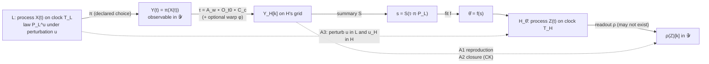

# Dynamics fitting across scales: problem statement and paper check (v0)

2026-11-06 · topic `cross-scale-time` · cycle-000 · done-definition item 2 + candidate question Q-C · report type: architecture (a pre-implementation contract a prototype is scored against)

Reads with: `__threads__/cross-scale-time/INTENT.md` (the vocabulary this revises), `01-dynamics_fitting_literature_v0.md` (the literature map), `00-literature_seed_v0.md` (the seed). The toy benchmark (`03-toy_benchmark_findings_v0.md`) is written in parallel and was not read for this report.

## Executive summary

- **Problem.** Fit the parameters θ of a high model H from the projected, time-mapped dynamics of a low model L, after the fact, and decide by measurement whether the fit is adequate. The INTENT states this in a rough vocabulary `[source: __threads__/cross-scale-time/INTENT.md §Working vocabulary]`. This report makes it formal enough to score.
- **What is defined.** L, H, π, a new readout ρ, τ = A_w ∘ O_{t0} ∘ C_c (with an optional warp φ), three classes of summary with an operational shuffle test, four fit forms, and adequacy as a vector of four scores (A0 ratios, A1 reproduction, A2 closure, A3 perturbation response).
- **Two results of the paper check that change the picture.**
  1. *Unit invariance is free only for stationary summaries.* The p53–MDM2 baseline is trivially unit-invariant because its summary (ΔΔG → S) carries no time dimension. Once a dynamic summary sets one rate in an H whose other rates are hand-set, the declared unit (1 step = 1 h) becomes a calibration, not a convention. This qualifies INTENT stance 3.
  2. *Adequacy tests A1 and A2 need H to have a state that corresponds to π(L).* In two of the three gaps, including the p53–MDM2 baseline, π(L) sets a parameter of H rather than matching a variable of H. Then A1 and A2 cannot be computed against L at all.
- **Guard verdicts.** 9 terms pass, 3 are kept as declared slots only (offset, warp φ, feedback: they have domain instances but no test on the milestone-1 toy), 1 term is overfitted as written (kinetic summaries "koff, residence time" — replaced by their domain-neutral forms). All four literature-map adjustments are folded in; one (auxiliary model) is accepted provisionally.
- **Non-goals.** No code, no edit to `INTENT.md`, no edit to `p53-mdm2`, no human → planet build.

## The problem as a pipeline

The dashed edges are the adequacy tests. They compare L and H only through 𝒴, at H's resolution. Nothing in the pipeline compares H's *other* variables (e.g. other MaBoSS nodes) with L, because L says nothing about them.

## 1. Formal statement

### 1.1 Objects

**Low model L.** A stochastic process X(t) with values in a state space 𝒳, indexed by time t on L's clock, measured in unit u_L. L may be run under a perturbation (protocol, forcing, mutation) u ∈ 𝒰, with u = 0 the base condition. Its law is P_L^u. Only finitely long observations are available: total length T_obs^L.

**Projection π.** A map π : 𝒳 → 𝒴, giving Y(t) = π(X(t)). π is a **declared modelling choice**, not a given (§4.4).

**High model H.** A parametrised family of processes Z_θ(s) with values in 𝒵, indexed by time s on H's clock in unit u_H, with parameters θ ∈ Θ and a perturbation input u_H ∈ 𝒰_H. H is observed or output at resolution Δ_H (its step, or its output tick).

**Readout ρ (new).** A map ρ : 𝒵 → 𝒴 that says which function of H's state is the same quantity as π(L). It may not exist (§4.2). When it exists, L and H can be compared directly; when it does not, π(L) only enters H through θ.

**Time map τ.** A map from 𝒴-valued trajectories on T_L to 𝒴-valued sequences on H's grid, composed of separate components:

    τ = A_w ∘ O_{t0} ∘ C_c        (optionally A_w ∘ φ ∘ O_{t0} ∘ C_c)

| Component | Action on time | Invertible? | Status |
|---|---|---|---|
| C_c, unit conversion | t ↦ t / c, with c = (one u_H expressed in u_L). For ps → h, c = 3.6 × 10¹⁵ | yes | a declared constant, never fitted `[source: INTENT.md Stance §3]` |
| O_{t0}, offset | t ↦ t − t0 | yes | declared; only matters when L is non-stationary or forced |
| φ, warp | t ↦ φ(t), monotone, not affine | yes | optional; for regime-dependent clocks (§4.3) |
| A_w, aggregation | Y_H[k] = (1/w) ∫_{kw}^{(k+1)w} Y(t) dt (window mean), or Y_H[k] = Y(kw) (sampling at lag w) | **no** | a modelling choice with physical length w (in u_H after C) |

C, O and φ only relabel time. A_w discards information, and is the one component that changes what can be estimated `[source: 01-dynamics_fitting_literature_v0.md, Headline 4]`.

**Summary s.** A functional S of the law of the mapped observable: s = S(τ_* π_* P_L^u), possibly over several u. Three classes, by the narrowest law S depends on:

| Class | S depends on | Examples | Time dimension |
|---|---|---|---|
| **one-time (stationary)** | only the one-time marginal μ of Y_H under u = 0 | mean occupancy, equilibrium constant, mean emission rate | none |
| **multi-time (dynamic)** | joint laws of Y_H at ≥ 2 times under u = 0 | autocorrelation, waiting-time distribution, transition matrix at a lag, memory kernel | [time]^k, k ≠ 0 |
| **response (dynamic, forced)** | the family P_L^u for u ≠ 0 | step or impulse response, adoption curve after a shock | [time]^k |

**Precise criterion.** S is *one-time* iff S(P) = S(P′) whenever P and P′ have the same one-time marginal. Operational test (computable on any trajectory set): **shuffle test** — permute the time order of the Y_H samples (destroying all multi-time structure, keeping the marginal); a one-time summary is unchanged in expectation, a multi-time summary is not. A response summary is one that cannot be computed without data at u ≠ 0.

Two consequences:
- The class must be judged on Y_H, after A_w, not on Y. A window mean preserves the mean but its variance depends on Y's autocorrelation over the window, so "variance of Y_H" is a one-time summary of Y_H that hides multi-time information about Y `[assumption: standard property of window averages; not checked against a cited source]`.
- One-time summaries are dimensionless in time, so they are untouched by C. Every multi-time or response summary carries a time dimension and is rescaled by C. This is why unit invariance matters only once a dynamic summary is used (§2.1).

**Fit f.** A rule θ̂ = f(s). Four forms:

| Form | Rule | Needs H to be run? | Instance |
|---|---|---|---|
| F1 closed form | θ̂ = g(s) | no | residence time → rate = 1/mean; ΔΔG → S logistic `[source: examples/p53_mdm2/README.md §The four hops, hop 3]` |
| F2 minimum distance | θ̂ = argmin_θ d(s, S(ρ_* P_H^θ)) | yes, and needs ρ | moment matching, MSM-to-CTMC fitting |
| F3 auxiliary model (indirect inference) | fit auxiliary β to Y_H and to ρ(Z_θ); θ̂ = argmin_θ ‖β_L − β_H(θ)‖ | yes, and needs ρ | Smith 1993; Gouriéroux, Monfort & Renault 1993 `[source: 01-…literature_v0.md, Concepts that pass the guard]` |
| F4 likelihood / Bayesian / ABC | posterior over θ given Y_H | yes | ABC summary selection, Fearnhead & Prangle 2012 `[source: 01-…literature_v0.md, Statistics]` |

### 1.2 Characteristic times and the ratios adequacy depends on

All times are expressed in u_H after C, so every ratio below is dimensionless and invariant under any change of either unit.

| Symbol | Definition (computable) |
|---|---|
| t_L | slowest relaxation time of Y: the integrated autocorrelation time of Y, or the slowest implied timescale of a transition matrix estimated from Y |
| t_H(θ) | slowest relaxation time of ρ(Z_θ), from H's generator or simulated autocorrelation; when ρ does not exist, the time constant of the H process that θ enters |
| Δ_H | H's resolution (step, or output tick) |
| w | the aggregation window or lag in τ |
| T_obs | the length of L's observation |

| Ratio | Meaning | Expected regime |
|---|---|---|
| ε = t_L / t_H | scale separation | ε ≪ 1: L equilibrates within one H relaxation; a one-time summary should be adequate (quasi-steady state) `[source: 00-literature_seed_v0.md, family A]` |
| ω = w / t_L | window against L's memory | ω ≪ 1: τ keeps L's fast structure; ω ≫ 1: τ averages it out, and a Markov H at that w is plausible |
| δ = Δ_H / t_L | H's resolution against L's memory | δ ≳ 1 is needed for a memoryless H at its own resolution `[assumption: the MSM lag-time argument of Prinz et al. 2011 transposed to H's grid; 01-…literature_v0.md, Concepts]` |
| η = T_obs / t_L | identifiability | η ≫ 1 needed to estimate any multi-time summary. η < 1 makes the dynamic summary unidentifiable, whatever the method |

Q-A's question "at what ratio does a stationary summary stop being adequate" `[source: INTENT.md §Candidate first questions]` is then: find the critical ε* (at given ω, δ) where A1–A3 first fail with a one-time summary.

### 1.3 Adequacy

Adequacy is a **vector of scores**, not a pass/fail flag. A fit is adequate at a given tolerance if every computable component passes; a component that cannot be computed is reported as `not testable`, never as a pass.

| Score | Definition | Computable when |
|---|---|---|
| **A0 regime** | report (ε, ω, δ, η) | always (t_L needs η ≳ 1) |
| **A1 reproduction** | D_rep = max over *held-out* statistics q of \|q(Y_H) − q(ρ(Z_θ̂))\| / scale(q). Held-out means not used in s (anti-tautology: the fit cannot be scored on the statistic it was fitted to) | ρ exists |
| **A2 closure (Markov)** | discrete 𝒴: Chapman–Kolmogorov D_CK(k) = ‖T(kw) − T(w)^k‖ for k = 2…K, from Y_H; plus the implied-timescale plateau t_i(w) = −w / ln λ_i(w) over w; plus the embedding check, i.e. does T(w) have a valid generator (matrix logarithm with non-negative off-diagonal entries) `[source: 01-…literature_v0.md, Prinz et al. 2011; Kingman 1962]`. Continuous 𝒴: the gain in one-step prediction from adding Y_H[k−1], Y_H[k−2]… to Y_H[k] (zero for a closed state) | ρ exists, or H's state is a function of Y_H |
| **A3 perturbation response** | for perturbations u_1…u_m not used in fitting: D_resp = max_j ‖R_L(u_j) − R_H(u_{H,j})‖, with R(u)[k] = E^u[Y_H[k]] − E^0[Y_H[k]]. Requires a declared perturbation map u ↦ u_H. Two modes: *transfer* (θ̂ fitted at u = 0, u_H applied) and *refit* (θ̂ refitted on each u, then the refitted family scored on a further held-out u) | ρ exists and a perturbation map is declared |

A3 is the literature map's headline 3 made into a test: matching the base state does not guarantee matching the response `[source: 01-…literature_v0.md, Headline 3; Abramov & Kjerland 2013; Metzcar et al. 2025]`.

### 1.4 Invariants (what must always hold)

- I1. Every component of τ (c, t0, φ, w), π, ρ and the perturbation map is declared and recorded, in physical time, with provenance (it is in scope to record them in USD `[source: INTENT.md §Scope]`).
- I2. Adequacy is scored only on statistics and perturbations not used to fit.
- I3. A score that cannot be computed is `not testable`, never `pass`.
- I4. Every reported ratio is dimensionless.

## 2. Testable criteria

### 2.1 Unit invariance

**Statement.** Let the pipeline output be the predictions P(θ̂) of H as functions of physical time (e.g. a node probability at physical time 5 h). For any λ, μ > 0:

- *rescale L's clock*: re-express L's time in a unit λ times smaller (t_L-values × λ) and set c ↦ λc;
- *rescale H's clock*: re-express H's time in a unit μ times smaller (s-values × μ), and set c ↦ c/μ, w ↦ μw, Δ_H ↦ μΔ_H, and every time-carrying parameter of H (rates ↦ rate/μ).

Then P(θ̂) is unchanged, and all of (ε, ω, δ, η) are unchanged.

**Test.** Run the pipeline at λ, μ ∈ {1, 10⁻³, 10³} (any spread of orders). For deterministic pipelines the difference must be at round-off; for stochastic ones, at the Monte-Carlo noise of a common-random-number run.

**What the test catches.** Any constant with a hidden time unit: a lag specified in frames, an optimiser tolerance on a rate, a fixed MaBoSS rate written in "steps".

**A consequence the paper check exposed: the H-side rule is the binding one.** The invariance holds only if *all* of H's time-carrying parameters are rescaled. In an H where θ̂ sets some rates and others are hand-set by the modeller in model units, the declared unit c is not a convention: changing it changes the fitted rate relative to the hand-set ones, and so changes predictions.
- With a one-time summary (dimensionless), this never shows: the current p53 baseline's S is dimensionless, and the MaBoSS unit is "accepted as the working value" without affecting anything `[source: INTENT.md Stance §3; examples/p53_mdm2/README.md §Not yet done]`.
- With a dynamic summary (koff → a MaBoSS rate), c enters the fitted rate as koff × c and the other rates of the 5-node network stay in model units `[source: examples/p53_mdm2/README.md §Key external inputs: the network is fetched verbatim]`. The declared hour then acts as a calibration constant.
- Toy test: an H with one fitted rate and one fixed rate; vary c; predictions must change if and only if the fixed rate is not converted with it.

**What invariance does NOT cover: the aggregation window.** Changing w in *physical* time at fixed units is not a symmetry. Rate estimates depend on the sampling interval (Honisch & Friedrich 2011; temporal-aggregation bias in econometrics), projection makes a Markov process non-Markov (Lade 2009), and a coarsely sampled chain may have no generator (Kingman 1962) `[source: 01-…literature_v0.md, Headline 4]`. Requirements on w instead:

- W1. w is declared in physical time and recorded (I1), never in frames or steps.
- W2. **Window sensitivity is reported**: θ̂(w) (in physical units) and the implied timescales t_i(w) over a grid around the chosen w0, at least [w0/4, 4·w0].
- W3. **Plateau or correction**: either θ̂(w) varies by less than a declared tolerance over that grid (the MSM implied-timescale plateau, transposed), or the estimator carries an explicit correction for w, or the fit is labelled window-dependent and A2 is expected to fail.
- W4. w ≤ Δ_H: H cannot be fitted at a resolution coarser than the one it is scored at `[assumption: follows from scoring A1/A2 at H's resolution; not from a source]`.

### 2.2 Measured adequacy

Stated in §1.3 as A0–A3; each is a number a toy script computes from simulated Y_H and simulated ρ(Z_θ̂). The INTENT's requirement that adequacy depends on dimensionless ratios `[source: INTENT.md §Working vocabulary, "Measured adequacy"]` becomes: *report the curves A1(ε), A2(ε), A3(ε) at fixed (ω, δ), for each summary class, and locate the ε at which each crosses tolerance.*

| Toy quantity | How a script gets it |
|---|---|
| t_L | integrated autocorrelation of Y, or −w / ln λ₂ of the estimated transition matrix |
| A1 | held-out statistics on Y_H vs ρ(Z_θ̂): e.g. fit on the mean, score on autocorrelation at lags 1…K and on the waiting-time histogram |
| A2 | estimate T(w), T(2w)… by counting; compare T(kw) with T(w)^k; take logm(T(w)) and check its off-diagonals |
| A3 | change one L parameter (the toy's "mutation"), apply the declared u_H, compare the mean step response on H's grid |

## 3. Three scale gaps

Molecule → cell is grounded in the repo. Cell → tissue rests on two citations from the literature map. Human → planet is a paper check only `[source: INTENT.md §Scope, Out]`.

| Term | Molecule → cell (p53–MDM2: MD → MaBoSS) | Cell → tissue (Boolean network → agent-based tissue, PhysiBoSS-style) | Human → planet (agent-based human activity → climate / IAM) |
|---|---|---|---|
| **L** | MD of the complex. Available: banyan job 119, 100 ps, one replica, plumbing force field `[source: examples/p53_mdm2/README.md §Not yet done]`. *The current baseline's s does not come from L at all*: ΔΔG comes from DDMut-PPI on a static structure `[source: README §The four hops, hop 2]` | per-cell MaBoSS network, run per cell `[source: 01-…literature_v0.md, Metzcar et al. 2025; PhysiBoSS tutorial arXiv:2406.18371]` | agent-based model of household / firm activity |
| **H** | 5-node MaBoSS p53_Mdm2 oscillator; θ = `$KMn_pMCD`, `$KMn_pMC` `[source: README §The four hops, hop 3]` | agent-based tissue; θ = agent rule rates (proliferation, death, migration) `[assumption: typical PhysiCell agent parameters; not read from a source]` | climate emulator or IAM: FAIR impulse-response, or IAM pathway parameters `[source: 01-…literature_v0.md, Smith et al. 2018; Beckage et al. 2018]` |
| **π** | bound / unbound, e.g. a contact cutoff on the interface — a choice of cutoff | phenotype node states (e.g. an apoptosis node) | aggregate emissions, land use — chosen variables `[source: 01-…literature_v0.md, §Where the vocabulary breaks]` |
| **ρ** | **none**: no MaBoSS node is the bound state; S scales a rate on the Mdm2 transitions | partial: agent phenotype is a thresholded function of node states `[source: 01-…literature_v0.md, Metzcar et al. 2025, "thresholding"]` | **none**: emissions are a *forcing* of H, not a state of H |
| **Coupling pattern** | parameter (π sets θ of a different variable) | state (π ↔ agent phenotype) | forcing (π is an input series to H) |
| **C_c** | ps → h, c = 3.6 × 10¹⁵ ps per h, under the assumed 1 unit = 1 h `[source: README §Departmental layering, bio:maboss:timeUnit]` | MaBoSS unit → tissue clock (PhysiBoSS takes the MaBoSS unit as calibrated by the modeller `[source: 00-literature_seed_v0.md, §Cell-level side]`) | days → years |
| **O_t0** | identity; L is stationary, offset irrelevant `[source: README §The four hops, hop 5: identity layer offset]` | per-cell: time since division or birth — a *heterogeneous* offset across agents `[assumption]` | calendar year / pre-industrial baseline; matters because L is non-stationary `[assumption]` |
| **φ** | none | possibly cell-cycle phase as a biological clock `[assumption]` | policy regimes, calendar effects `[source: 01-…literature_v0.md, "time map can be a modelling choice"]` |
| **A_w** | MaBoSS is continuous-time, so no inherent window; output tick Δ_H = 0.1 unit (500 frames over max_time = 50) `[source: README §The thesis]` | the intracellular update interval between network and agent `[assumption: PhysiBoSS-style coupling interval]` | annual aggregation |
| **s, one-time** | ΔΔG → Kd fold change → fraction bound `[source: __reports__/p53-mdm2/19-cycle012_findings_v0.md §What the literature says, point 3]` | steady-state node probability | mean emission rate |
| **s, multi-time** | waiting-time distribution of unbinding (koff, residence time) | distribution of time to apoptosis-node activation | autocorrelation of emissions, response lags |
| **s, response** | change in bound fraction under a mutation; mutants *are* perturbations `[source: README §The thesis, Genotype variants]` | response to a single-cell intervention `[source: 01-…literature_v0.md, Metzcar et al. 2025]` | adoption curve after a policy shock |
| **f** | F1: logistic, m, k ad-hoc placeholders `[source: README §Key external inputs]` | F1 (waiting time → agent rate) or F2 | F3 indirect inference (agent-based fishery, Carrella et al. 2018, unconfirmed as model-to-model) `[source: 01-…literature_v0.md]` |
| **t_L** | binding/unbinding on the ms scale (stopped-flow, two-state) `[source: 00-literature_seed_v0.md, J Phys Chem B 2018]`; MDM2–peptide MSM needed sub-ms sampling `[source: 19-cycle012 §What the literature says]` | network relaxation in MaBoSS units | years (policy, adoption) |
| **t_H** | hours, if 1 unit = 1 h; the 5–6 h pulse period is a sanity anchor only `[source: 19-cycle012 §Uncertainty]` | hours to days (cell cycle) `[assumption]` | decades to centuries (climate inertia) `[source: 01-…literature_v0.md]` |
| **ε** | ≈ 10⁻³ s / 3.6 × 10³ s ≈ 3 × 10⁻⁷ `[assumption: computed from the two order-of-magnitude anchors above]` | ~ 1 possible `[assumption]` | ~ 0.1–1: weak separation `[source: 01-…literature_v0.md, "Timescale separation is weak"]` |
| **η** | 100 ps against ms: ≈ 10⁻⁷. *No multi-time summary of binding is identifiable from the available L* `[source: 19-cycle012 point 3: "Our 100 ps run also cannot yield kon/koff"]` | ≫ 1 (the network is cheap to run) `[assumption]` | limited by data length and regime changes |
| **Adequacy computable?** | A1, A2: **not testable** (no ρ). A3: only if a binding node or sub-model is added | A1–A3 testable at the phenotype level | A1, A2: not testable against L (no ρ). A3: response of H to a forcing derived from L |
| **Feedback** | none `[source: INTENT.md §Working vocabulary]` | tissue → cell inputs (substrates, contact) `[assumption: PhysiBoSS-style coupling; not confirmed in a read source]` | strong `[source: 01-…literature_v0.md, Beckage et al. 2018; Moore et al. 2022]` |

**A prediction the table makes for Q-B.** With ε ≈ 3 × 10⁻⁷, binding equilibrates many orders of magnitude faster than a MaBoSS hour, so the framework predicts that for binding alone *Kd decides* and koff or residence time cannot change MaBoSS phenotype probabilities except through Kd `[assumption: quasi-steady-state argument, 00-literature_seed_v0.md family A; holds only if the ms anchor is right for these mutants]`. Dynamic summaries can matter only for an L process whose t_L approaches hours (a slow conformational change, or modification kinetics), or through drug-like slow unbinding (the residence-time model, Copeland et al. 2006 `[source: 00-literature_seed_v0.md]`). That is a falsifiable prediction for Q-B, and a reason to choose its L process with care.

## 4. Where the vocabulary breaks

### 4.1 Molecule → cell

- **There is no ρ.** MaBoSS has no node for the complex; the fitted quantity scales the Mdm2 transition rates `[source: README §The four hops, hop 3]`. So A1 and A2 cannot be computed against L. The INTENT's adequacy question "is a memoryless MaBoSS rate enough?" `[source: INTENT.md]` is not testable as posed without adding a bridge observable to H (a binding sub-model whose state is π).
- **L is not the source of the baseline's s.** ΔΔG comes from a structure-based predictor. In the vocabulary, the baseline's "L" is DDMut-PPI, a model with no clock. The comparison in done-definition item 4 is therefore between two different L's, not two summaries of one L.
- **η ≪ 1.** The available trajectory is ~10⁷ times shorter than t_L. Any dynamic summary of binding needs new MD, which the INTENT puts out of scope unless planned and approved `[source: INTENT.md §Scope, Out]`.
- **Units: the hour becomes load-bearing** with any dynamic summary (§2.1).

### 4.2 Cell → tissue

- **ρ is many-to-one and thresholded.** Agent behaviour is a threshold of node states; two network dynamics with the same phenotype time course can differ in A3 `[source: 01-…literature_v0.md, Metzcar et al. 2025]`.
- **The offset is per agent.** O_{t0} is a field over agents, not one constant. The vocabulary's single τ does not cover a population of L instances that start at different times `[assumption]`.
- **Feedback is native.** The standard practice is lock-step coupling (network inside each agent), which is out of scope `[source: INTENT.md Stance §1]`. The after-the-fact alternative — replace the embedded network by fitted agent rates — is meaningful but must hold the tissue inputs fixed, or the fit confounds closure with feedback.

### 4.3 Human → planet (paper check)

- **π(L) is a forcing of H, not a state of H.** The INTENT's adequacy definition ("does H reproduce π(L)") does not apply; H does not produce emissions, it responds to them. Adequacy must move to A3 only: does H forced by the fitted series respond as H forced by π(L) itself.
- **Weak separation (ε ~ 1)**: one-time summaries are expected to fail, and methods without scale separation (data-driven Mori–Zwanzig, Ruelle response) matter more `[source: 01-…literature_v0.md, §Where the vocabulary breaks]`.
- **Non-stationarity** makes the shuffle test and A2 ill-posed, because both assume a stationary base law `[source: 01-…literature_v0.md, "This also strains stationarity"]`.
- **Feedback cannot be excluded**, so the after-the-fact fit is confounded `[source: 01-…literature_v0.md, "Feedback is close to unavoidable"]`.
- **"Low" and "high"** are not spatial scales here but levels of aggregation. The vocabulary survives if L and H are read as fine- and coarse-grained, not small and large `[assumption]`.

### 4.4 The abstraction guard, term by term

Guard: (i) an instance in ≥ 2 scale gaps from different domains; (ii) a computable test on the toy system `[source: INTENT.md §Abstraction guard]`. Toy = "a fast stochastic process L modulates a slow process H", tunable ratio, exact reference `[source: INTENT.md, Q-A]`.

| Term | (i) instances | (ii) toy test | Verdict |
|---|---|---|---|
| L, H | all three gaps | the toy's two processes | **pass** |
| π | all three; a choice in all three, not only for social systems | vary the cutoff/projection; watch s and A2 change (Lade 2009) | **pass** (as a declared choice) |
| ρ (new) | cell → tissue (thresholded phenotype); toy by construction; *absent* in molecule → cell and human → planet | compare ρ(Z) with Y_H | **pass**; its absence is itself a recorded outcome |
| C_c | all three | §2.1 rescaling run | **pass** |
| O_t0 | cell → tissue (per agent), human → planet (calendar) | none on a stationary toy | **declared slot**: too abstract for the milestone-1 toy; needs a forced or non-stationary toy variant |
| φ | human → planet; cell → tissue only by assumption | none on the toy | **declared slot**, weakest; one solid instance only |
| A_w | all three | θ̂(w), t_i(w) curves (W2) | **pass** |
| s, one-time / multi-time / response | all three, each class | shuffle test; dimension check | **pass** |
| "koff, residence time" as the dynamic summary | molecule → cell only | yes | **overfitted** as written; replace by "waiting-time distribution" and "autocorrelation", which pass |
| f, forms F1–F4 | F1 all three; F3 econometrics and ecology, model-to-model unconfirmed | each computable | **pass**; F3 provisional |
| Adequacy A1, A2 | cell → tissue and toy only (need ρ) | yes | **pass**, but *not testable* in 2 of 3 gaps |
| Adequacy A3 | all three (mutants, single-cell interventions, policy shocks) | yes | **pass**; the only adequacy test that applies in every gap |
| Ratios ε, ω, δ, η | all three | yes | **pass** |
| Feedback | cell → tissue, human → planet | none on a one-way toy | **declared slot** (value "none" in milestone 1, per INTENT scope) |

### 4.5 The literature map's four proposed adjustments

| Proposal `[source: 01-…literature_v0.md, "Possible adjustments"]` | Decision | Where |
|---|---|---|
| Perturbation response as an adequacy test | **accepted** as A3; it is the only adequacy score computable in all three gaps | §1.3 |
| Aggregation window biases estimates (under τ) | **accepted**: τ split into C, O, φ, A_w; W1–W4 replace invariance for w | §1.1, §2.1 |
| Auxiliary model as a fit form | **accepted provisionally** as F3: its guard (i) rests on econometrics and an agent-based fishery, and model-to-model use across a gap was not confirmed in any source | §1.1 |
| π as a modelling choice | **accepted and generalised**: π is a declared choice in every gap (an MD contact cutoff is a choice too), not only for social systems; and the paper check adds ρ, the H-side counterpart | §1.1, §4.4 |

## 5. Proposed vocabulary revision (proposal for the PI; INTENT.md is not edited)

| Term | Meaning | Molecule → cell (p53–MDM2) | Human → planet (illustrative) |
|---|---|---|---|
| **Low model L** | A process on its own clock, possibly under a perturbation u; observed for T_obs | MD of the complex (job 119: 100 ps) | Agent-based model of human activity |
| **High model H** | A process with parameters θ, its own clock and resolution Δ_H | 5-node MaBoSS network | Climate emulator or IAM |
| **Projection π** | A declared choice of what of L's state is passed up | bound / unbound (cutoff chosen) | aggregate emissions, land use |
| **Readout ρ** *(new)* | Which function of H's state is the same quantity as π(L); may not exist | none: S scales a rate | none: emissions force H |
| **Coupling pattern** *(new)* | state (π ↔ ρ), parameter (π sets θ of another variable), or forcing (π is an input to H) | parameter | forcing |
| **Time map τ** | A_w ∘ O_t0 ∘ C_c, optional warp φ: unit conversion (declared), offset (declared), window (a choice, sensitivity reported) | ps → h; identity offset; no window | days → years; calendar offset; annual window |
| **Summary s** | one-time (marginal only), multi-time (joint laws at ≥ 2 times), response (needs u ≠ 0); distinguished by the shuffle test | fraction bound / unbinding waiting times / mutant shift | mean emission rate / emission autocorrelation / adoption after a shock |
| **Fit θ = f(s)** | closed form, minimum distance, auxiliary model, or likelihood / Bayesian | logistic ΔΔG → S (placeholder) | indirect inference on an auxiliary model |
| **Characteristic times and ratios** *(new)* | ε = t_L/t_H, ω = w/t_L, δ = Δ_H/t_L, η = T_obs/t_L | ε ≈ 3 × 10⁻⁷, η ≈ 10⁻⁷ | ε ~ 0.1–1 |
| **Adequacy** | A0 ratios; A1 held-out reproduction; A2 closure (CK, timescale plateau, embedding); A3 perturbation response. Uncomputable scores are "not testable" | A1, A2 not testable; A3 needs a binding sub-model | A3 only |
| **Perturbation map** *(new)* | How a perturbation of L is expressed in H (u ↦ u_H) | mutant → change of S | policy shock → forcing change |
| **Feedback** | Whether H also drives L | none (one-way) | strong |

Properties, revised:
- **Unit invariance**: rescaling either clock, with c, w, Δ_H and *every* time-carrying parameter of H rescaled consistently, leaves the predictions in physical time and all ratios unchanged. It does not cover w; W1–W4 do. It is free for one-time summaries and binding for the others.
- **Measured adequacy**: A0–A3 as functions of ε at fixed ω, δ; η ≫ 1 is a precondition for any multi-time summary.

## Alternatives considered

| Decision | Options | Chosen | Trade-off accepted |
|---|---|---|---|
| Stationary vs dynamic criterion | (a) "involves time derivatives"; (b) depends only on the one-time marginal; (c) has a time dimension | (b), with the shuffle test as operation and (c) as a consequence | the class must be judged after A_w, so a window can hide multi-time information inside a one-time summary |
| Adequacy | single scalar vs vector | vector A0–A3 with explicit "not testable" | no single headline number per method |
| Time map | one τ vs separate components | separate C, O, φ, A_w | more fields to record; but only A_w needs a sensitivity analysis |
| H-side counterpart of π | leave implicit vs add ρ and coupling pattern | add both | the vocabulary grows by two terms, and two of three gaps lose A1 and A2 |
| Unit invariance scope | apply to L-side only vs also require H's hand-set rates to be converted | require both | the p53 hour stops being a free convention once a dynamic summary is used |

## Risks and mitigations

| Risk | Mitigation |
|---|---|
| The toy has ρ by construction, so it validates A1/A2 in a regime the real gaps do not have | require Q-A to also score a "parameter-pattern" toy variant (no ρ) using A3 only |
| Fitting and scoring on the same statistics (tautology) | invariant I2: held-out statistics and perturbations only |
| A declared unit silently acting as a calibration | the mixed-H unit test of §2.1 |
| Window chosen to make the fit look good | W2: report the whole θ̂(w) curve, not one w |
| Dynamic summaries proposed for p53 binding where η ≈ 10⁻⁷ | report η first; no dynamic summary without η ≫ 1 |
| Vocabulary drifts to fit human → planet and loses the toy | the guard table (§4.4) is re-run on each revision |

## Candidate steering questions

1. **Accept the readout ρ and the coupling pattern (state / parameter / forcing) into the vocabulary?** If yes: for the p53 baseline (parameter pattern), should adequacy be measured by adding a binding sub-model to H, so A1/A2 become computable, or by A3 only?
2. **Unit invariance in a mixed H.** Once a dynamic summary sets one MaBoSS rate while the other rates stay hand-set, the declared 1 h unit acts as a calibration. Is that acceptable, should all H rates be re-expressed in physical time first, or should stance 3 be reworded to say that units are free only for dimensionless summaries?
3. **Window tolerance.** Should the PI set the plateau tolerance and grid for W3 (e.g. θ̂ within X % over [w0/4, 4·w0]), or let Q-A's results propose it?
4. **Summary criterion.** Accept the three classes (one-time / multi-time / response) and the shuffle test as the operational definition of "stationary vs dynamic"?
5. **Perturbation map.** For A3, is u ↦ u_H part of the declared problem (as for p53 mutants → S) or something to be fitted?
6. **Offset, warp and feedback.** Keep them as declared slots without a milestone-1 test, or extend the toy with a forced, non-stationary variant now?
7. **Q-B's L process.** With ε ≈ 3 × 10⁻⁷ for binding, the framework predicts Kd decides. Should Q-B test that prediction as stated (a cheap confirmation), or target a slower L process where a dynamic summary could matter?

## What I am uncertain about

- The ms binding anchor, the hour-scale t_H, and therefore ε ≈ 3 × 10⁻⁷, are order-of-magnitude values from secondary sources that were themselves read from abstracts `[source: 00-literature_seed_v0.md, §How this was produced]`; neither was checked for the specific mutants.
- All cell → tissue entries tagged `[assumption]` (offset per agent, coupling interval, feedback through substrates, typical agent rates) come from general knowledge of PhysiBoSS-style models, not from a source read here. The cited PhysiBoSS tutorial and Metzcar et al. were not opened.
- The claim that window-mean variance hides multi-time information, and requirement W4, are my own derivations, untested.
- The δ ≳ 1 condition for a memoryless H is a transposition of the MSM lag argument, not a cited result.
- I did not read `03-toy_benchmark_findings_v0.md` or the toy code, so the toy may not yet compute every score in §2.2. Whether it has a "no ρ" variant is unknown.
- Alternative framing considered and rejected: treating the forcing pattern (human → planet) as out of the vocabulary altogether. Rejected because A3 still applies and the guard would otherwise lose its only social instance.
