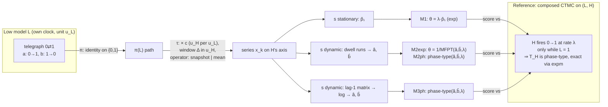
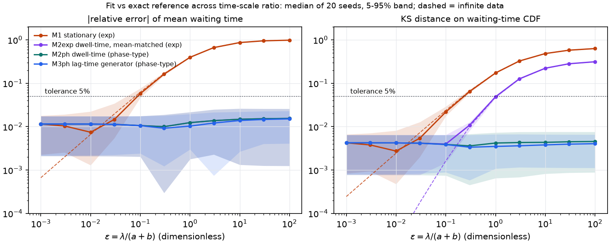
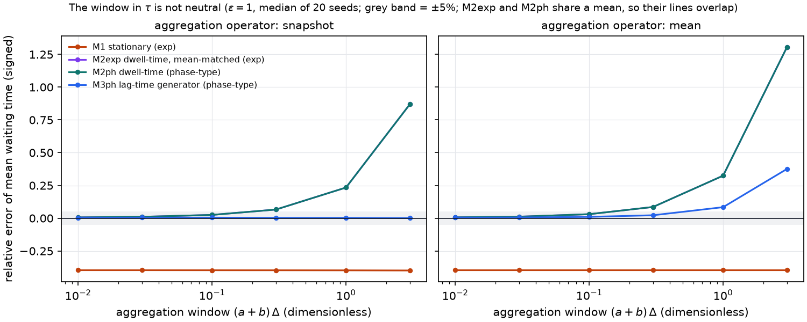
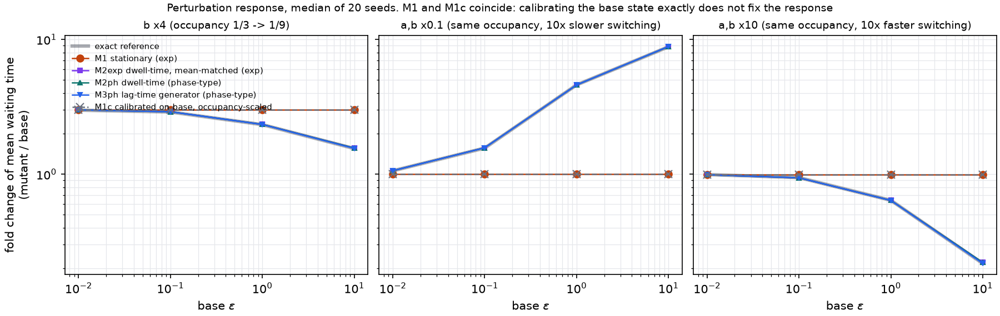

# Cross-scale time: toy benchmark (Q-A) findings (v0)

Date: 2026-11-06

---
type: findings
topic: cross-scale-time
date: 2026-11-06
version: v0
prior-version: none
key-metric: M1 adequacy threshold eps* (5% on mean waiting time, p1 = 1/3): 0.079 (prior: N/A, delta: N/A)
decision-required: confirm
---

All numbers come from one seeded run, `examples/cross_scale_time/outputs/run_20261106T003327Z/` (seed 20261106, 20 replicates, committed in `9e98729`). They reproduce exactly on rerun, because the same seed gave identical CSV values in two earlier runs that were discarded [source: `examples/cross_scale_time/outputs/run_20261106T003327Z/manifest.json`]. "Median [5–95%]" is taken over the 20 replicate L trajectories.

## Headline Result

metric: smallest time-scale ratio ε = λ/(a+b) at which the stationary fit M1 misses H's mean waiting time by more than 5%
value: 0.079 (numeric, infinite data) vs 0.0789 (closed form)
unit: dimensionless
prior: N/A (first run)
direction: new

The other answers to the brief:
- **Unit invariance holds exactly** when τ declares its window in H units. Rescaling L's clock by 10⁻¹² to 10⁶, or H's clock by 1/3600 to 3600, changes no prediction by more than 5×10⁻¹⁴. A negative control that declares the window in L units breaks invariance by up to +787% [source: `unit_invariance.csv`].
- **The aggregation window is not neutral**, as headline 4 of the literature map predicted. M1 is exactly window-neutral under mean aggregation. The dwell-time method M2 drifts to +23% (snapshot) and +32% (mean) at a window of one L relaxation time (ε = 1). The lag-time generator M3 stays within 1% under snapshots but drifts to +8% under mean-then-threshold [source: `window_sweep_summary.csv`].
- **Perturbation test: matching the base state does not mean matching the response.** At base ε = 1, a mutant that keeps L's occupancy and switches 10× slower raises the reference mean waiting time 4.6×. M1 predicts 1.0×. So does M1c, which is calibrated to match the reference base state exactly. M2 and M3 predict 4.6× within 0.1% (median) [source: `perturbation_summary.csv`].

## Setup (model first)

- **Ground truth.** The reference is H's waiting time T from stationary L. Its sub-generator is S = [[−a, a], [b, −(b+λ)]] and its initial vector is (π₀, π₁). The survival is P(T > t) = α·e^{St}·1, and E[T] = 1/(λπ₁) + π₀/(a+b). The reference agrees with a direct Monte Carlo of the joint system at ε = 1 on the mean (within 4 SE) and on the CDF (KS below the 1% critical value) [source: `examples/cross_scale_time/tests/test_toy_benchmark.py::test_reference_matches_monte_carlo`].
- **Closed form for M1's error.** E[T]·θ_M1 − 1 = −επ₀/(1+επ₀). The group that controls M1's adequacy is therefore επ₀ = λb/(a+b)², not ε alone [source: derivation in `toy_benchmark.py::mfpt`, checked numerically in `test_m1_matches_reference_as_eps_to_zero`].
- **Inputs to every method.** The methods see only the projected L series x_k, τ, and H's declared coupling (rate λ, fires while π(L) = 1). They never see a or b [source: `toy_benchmark.py::fit_all`].
- **Base case.** a = 1, b = 2 per u_L (p₁ = 1/3) and c = 10⁻³ u_H per u_L. Each replicate's L run lasts 10⁴ u_L, about 6,700 L cycles. The default τ is mean aggregation with (a+b)Δ = 0.01. ε is swept by changing λ, so all ε values share the same L data [source: `manifest.json`].
- **Infinite-data rows.** These give each method's functional form its exact summary. They separate model error from estimation error. For M2ph and M3ph the form *is* the reference, so their infinite-data error is 0 by construction.

## Results Tables

### 1. Sweep over ε (default τ; median over 20 replicates)

| ε | M1 mean err, finite [5–95%] | M1 mean err, ∞ data | M1 KS | M2exp KS | M2ph KS | M3ph KS |
|---|---|---|---|---|---|---|
| 0.001 | +0.4% [−1.6, +1.6] | −0.07% | 0.004 | 0.004 | 0.004 | 0.004 |
| 0.01 | −0.2% [−2.1, +1.0] | −0.66% | 0.003 | 0.004 | 0.004 | 0.004 |
| 0.03 | −1.5% [−3.4, −0.3] | −2.0% | 0.005 | 0.004 | 0.004 | 0.004 |
| 0.1 | −5.8% [−7.6, −4.7] | −6.3% | 0.022 | 0.004 | 0.004 | 0.004 |
| 0.3 | −16.2% | −16.7% | 0.064 | 0.011 | 0.004 | 0.003 |
| 1 | −39.7% | −40.0% | 0.173 | 0.049 | 0.004 | 0.004 |
| 3 | −66.5% | −66.7% | 0.326 | 0.126 | 0.004 | 0.004 |
| 10 | −86.9% | −87.0% | 0.485 | 0.223 | 0.004 | 0.004 |
| 100 | −98.5% | −98.5% | 0.632 | 0.314 | 0.005 | 0.004 |

The mean error of M2exp, M2ph and M3ph stays between +0.5% and +1.3% (median) at every ε, with 5–95% bands inside [−2.0%, +2.6%]. M2exp and M2ph share their mean by construction. No method failed on any replicate [source: `eps_sweep_summary.csv`, `eps_sweep_infinite_data.csv`].

### 2. Adequacy thresholds ε* (infinite data, 0.5% ε grid)

| p₁ = a/(a+b) | tol | M1 on mean: numeric / closed form | M1 on KS | M2exp on KS |
|---|---|---|---|---|
| 0.1 | 5% | 0.059 / 0.058 | 0.16 | 3.16 |
| **1/3 (base)** | **5%** | **0.079 / 0.079** | **0.22** | **1.05** |
| 0.5 | 5% | 0.106 / 0.105 | 0.30 | 0.94 |
| 0.9 | 5% | 0.53 / 0.53 | 3.1 | 2.14 |
| 1/3 (base) | 1% | 0.0153 / 0.0152 | 0.042 | 0.30 |

M2exp's mean is exact at every ε. Its KS levels off at 0.10 to 0.64 as ε → ∞, depending on p₁ [source: `m1_thresholds.csv`].

### 3. Aggregation window: mean-waiting-time error at ε = 1 (median; ε = 0.1 in brackets)

| (a+b)Δ | operator | M1 | M2 (exp & ph) | M3ph |
|---|---|---|---|---|
| 0.01 | snapshot | −39.7% | +0.6% | +0.4% |
| 0.1 | snapshot | −39.7% | +2.5% | +0.5% |
| 0.3 | snapshot | −39.8% | +6.6% | +0.3% |
| 1 | snapshot | −39.8% | +23.4% [+3.9%] | +0.3% [+0.3%] |
| 3 | snapshot | −39.9% | +87.0% [+13.7%] | +0.1% [+0.2%], band [−3.7, +5.6] |
| 0.01 | mean | −39.7% | +0.7% | +0.5% |
| 0.1 | mean | −39.7% | +3.1% | +1.0% |
| 0.3 | mean | −39.7% | +8.6% | +2.2% |
| 1 | mean | −39.7% | +32.4% [+7.4%] | +8.4% [+3.7%] |
| 3 | mean | −39.7% | +130.6% [+31.0%] | +37.6% [+16.4%] |

The M3 two-state matrix logarithm never failed to embed (0 of 480 fits) [source: `window_sweep_summary.csv`].

### 4. Unit invariance (one L trajectory, ε = 1)

| Rescaling | Factors | Max relative change in mean, M1 / M2 / M3 | Max abs. change in survival |
|---|---|---|---|
| L clock, with c adjusted; window declared in u_H | 10⁻¹², 10⁻⁶, 10⁻³, 10, 10³, 10⁶ | ≤4.7×10⁻¹⁴ / 0 / 0 | ≤1.7×10⁻¹⁴ |
| H clock (λ, c, Δ adjusted) | 1/3600, 1/60, 60, 3600 | ≤2.6×10⁻¹⁴ / ≤6.7×10⁻¹⁶ / ≤2.2×10⁻¹⁶ | ≤9.5×10⁻¹⁵ |
| **Negative control:** window declared as a number of u_L | 10 | 6×10⁻¹⁵ / 2.2% / 0.36% | 0.008 |
| **Negative control** | 10³ | 4×10⁻¹⁵ / 787% / 138% | 0.67 |

Negative-control factors that push the window outside the trajectory's usable range were skipped [source: `unit_invariance.csv`, `toy_benchmark.py::unit_invariance`].

### 5. Perturbation: fold change of mean waiting time, mutant / base (median over 20 replicates)

| Mutant | base ε | Reference FC | M1 = M1c error | M2exp/M2ph error | M3ph error | M2exp mutant KS |
|---|---|---|---|---|---|---|
| b × 4 (p₁ 1/3 → 1/9) | 0.01 | 2.99 | +0.7% | +0.4% | +0.4% | 0.003 |
| b × 4 | 0.1 | 2.90 | +4.0% | +0.4% | +0.4% | 0.003 |
| b × 4 | 1 | 2.33 | +29% | +0.4% | +0.2% | 0.006 |
| b × 4 | 10 | 1.55 | +94% | +0.8% | +0.2% | 0.058 |
| a, b × 0.1 (same p₁, 10× slower) | 0.01 | 1.06 | **−5.5%** | +0.2% | +0.1% | 0.009 |
| a, b × 0.1 | 0.1 | 1.56 | −36% | +0.5% | +0.5% | 0.049 |
| a, b × 0.1 | 1 | 4.60 | −78% | −0.02% | +0.01% | 0.22 |
| a, b × 0.1 | 10 | 8.83 | −89% | +0.3% [−9, +6] | +0.6% | 0.31 |
| a, b × 10 (same p₁, 10× faster) | 0.01 | 0.994 | +0.2% | −0.4% | −0.4% | 0.001 |
| a, b × 10 | 0.1 | 0.944 | +5.5% | −0.4% | −0.3% | 0.001 |
| a, b × 10 | 1 | 0.640 | +56% | −0.1% | −0.2% | 0.002 |
| a, b × 10 | 10 | 0.217 | +358% | +1.7% | +0.1% | 0.052 |

M1c fits the base mean exactly (error 0 by construction). For a mutant it scales θ by the measured occupancy ratio, so its fold change equals M1's [source: `perturbation_summary.csv`].

## Observations

| Signal | Baseline / Expected | Observed [source] | Interpretation |
|---|---|---|---|
| M1 threshold | closed form ε* = tol / ((1−tol)·π₀) | 0.079 numeric vs 0.0789 closed form at 5%; agrees within the 0.5% grid at all four p₁ [source: `m1_thresholds.csv`] | The code and the derivation agree. Adequacy of a stationary summary is set by επ₀, so a threshold quoted in ε alone needs p₁ beside it. |
| Shape vs mean | a mean-matched exponential should fix M1's mean but not its shape | M2exp mean exact; KS > 5% from ε ≈ 1.05 (base) [source: `m1_thresholds.csv`] | A memoryless (MaBoSS-like) H is adequate on the **mean** at every ε *if* θ comes from dynamics (1/MFPT). It is adequate on the **distribution** only up to ε ≈ 1. Beyond that H needs a hidden phase. |
| Estimation noise floor | ~1/√(number of L cycles) ≈ 1.2% | 5–95% band of about ±1.6% on the mean for every method at small ε [source: `eps_sweep_summary.csv`] | At ~6,700 cycles, a 1% tolerance cannot be resolved. The finite-data M1 crossing of 5% falls between ε = 0.03 and 0.1, matching the closed form. |
| Window, snapshot | Literature: sampling biases naive rate estimates (Honisch & Friedrich 2011); the embedded generator should not | M2 +23% at (a+b)Δ = 1; M3 +0.3% [source: `window_sweep_summary.csv`] | Under snapshot sampling of a Markov L, the bias belongs to the estimator, not to the information. The matrix-log estimator removes it. |
| Window, mean-then-threshold | same as snapshot | M3 +8.4% at (a+b)Δ = 1, +37.6% at 3 [source: `window_sweep_summary.csv`] | The aggregation *operator* matters as well as the width. Averaging then thresholding makes the projected series non-Markov, so no lag-1 estimator can be unbiased. |
| Unit invariance | exact, if τ carries units | ≤5×10⁻¹⁴ when the window is in u_H; up to +787% when it is a raw number of u_L [source: `unit_invariance.csv`] | Invariance is a property of how τ is *declared*, not of any method. The provenance record must store Δ with its unit. |
| Response | Literature headline 3: base match ≠ response match | M1c matches the base mean exactly and still misses equal-occupancy mutants by −78% to +358% at ε = 1 to 10, and by −5.5% already at base ε = 0.01 [source: `perturbation_summary.csv`] | The p53-MDM2 case (equal ΔΔG, different k_off) maps onto this toy. A mutant that slows switching 10× moves ε 10× higher, so M1 must be judged adequate at the **mutant's** ε, not the base's. |

## Charts & Visualizations

*Figure 1.* |Relative error| of H's mean waiting time (left) and KS distance on its CDF (right) against ε. Lines are medians over 20 seeds, bands are 5–95%, and dashed lines are infinite data. Below ε ≈ 0.03 every method sits on the same estimation-noise floor.

*Figure 2.* Signed error of the mean against the aggregation window (a+b)Δ, for the two aggregation operators, at ε = 1. The grey band is ±5%.

*Figure 3.* Mutant/base fold change of the mean waiting time against base ε. The thick grey line is the exact reference. M1 and M1c coincide.

## Contradictions & Surprises

- At base ε = 0.01, M1's base-state mean error is only −0.66%, yet its fold-change error for the slow-switching mutant is −5.5%. Scaling a and b by 0.1 multiplies ε by 10, so a base state that passes the adequacy test can fail it after perturbation.
- M3 is the most window-robust method under snapshots, yet it degrades under the INTENT's own τ instance ("averaged over a MaBoSS step") [source: `__threads__/cross-scale-time/INTENT.md`]. The literal p53-MDM2 τ is the less favourable operator for dynamic summaries.
- The KS plateau of M2exp is bounded well below 1 (0.31 at p₁ = 1/3). A single correctly chosen rate is a decent shape approximation even at ε = 100. The large failures belong to M1, not to memorylessness as such.

## Uncertainty / limits (what I am uncertain about)

- **The toy is well-specified for M2ph and M3ph.** L is exactly a two-state Markov chain, and the phase-type H has exactly the reference's structure. Their success is expected and is not evidence they work when π(L) is non-Markov, as it is for MD [assumption: real MD projected to bound/unbound has hidden states and memory (Lade 2009, cited in `01-dynamics_fitting_literature_v0.md`)]. This benchmark does not test the closure (Markov) half of "adequacy". A misspecified variant is needed, such as a three-state L with a hidden state (see the steering questions).
- **H's coupling is given, not fitted.** Every method is told λ and that H fires while π(L) = 1. In p53-MDM2 that coupling is itself a modelling choice [assumption: no fitting of the coupling was attempted].
- **L starts stationary when H's clock starts.** A different initial condition changes the reference and the adequacy numbers.
- **Data volume.** Each replicate holds about 6,700 L cycles. A real MD run may contain only a handful of unbinding events, and then the noise floor, not the ε threshold, dominates [assumption: no p53-MDM2 MD trajectory exists yet, per `CLAUDE.md` §"Key Concepts" item 4].
- **Scoring.** KS is computed on a 4,001-point grid up to 8× the reference mean, and only the mean and the CDF are scored. MaBoSS phenotype probabilities at a fixed time are a different observable and were not scored. The thresholds use a 0.5% ε grid.
- **Not built.** No M3 indirect-inference variant was built. No multi-lag Chapman–Kolmogorov or implied-timescale check was run; M3 uses lag 1 only. The claim that a phase-type H can be written in MaBoSS as an extra hidden Boolean node is plausible but untested [assumption: MaBoSS simulates continuous-time Markov dynamics on Boolean states].

## Pointers

- Code: `examples/cross_scale_time/toy_benchmark.py` (commit `67f2b55`)
- Tests: `examples/cross_scale_time/tests/test_toy_benchmark.py` (commit `4e3257e`). Run with `/Users/hacker/Documents/src/AOUSD/forOUSD/bin/python3 examples/cross_scale_time/tests/test_toy_benchmark.py`
- Run: `examples/cross_scale_time/outputs/run_20261106T003327Z/` (commit `9e98729`): `eps_sweep_summary.csv`, `eps_sweep_infinite_data.csv`, `m1_thresholds.csv`, `window_sweep_summary.csv`, `unit_invariance.csv`, `perturbation_summary.csv`, `*_raw.csv`, `manifest.json`
- Literature map: `__reports__/cross-scale-time/01-dynamics_fitting_literature_v0.md` (headlines 3 and 4)
- Brief: `__threads__/cross-scale-time/INTENT.md`

## Candidate steering questions

1. **[now] Which H observable and tolerance define "adequate" for p53-MDM2?** The choices are the mean waiting time, the full waiting-time distribution, or MaBoSS phenotype probabilities at a fixed time. The answer decides between a single MaBoSS rate θ = 1/MFPT (adequate on the mean at every ε here) and a phase-type H with a hidden node (needed for shape beyond ε ≈ 1).
2. **[now] Should done-definition item 4 start by estimating ε·π₀ for p53-MDM2?** In this toy, the baseline θ = λ·p (the Kd route) stays within 5% only for επ₀ ≲ 0.053. For a mutant, the check has to be made at the mutant's ε.
3. **[next run] Approve a misspecified toy as the next benchmark?** The proposal is a three-state L with a hidden state, projected onto two. It tests the closure condition and a multi-lag Chapman–Kolmogorov check, both of which the current toy cannot exercise.
4. **[next run] Which τ convention should be recorded as provenance?** One option is to declare the window relative to L's relaxation time ((a+b)Δ), with a ceiling such as ≲ 0.1 for dwell-time summaries. The other is to make snapshot plus lag-generator the default, which is window-robust here, instead of the INTENT's "averaged over a MaBoSS step". Either way, Δ must be stored with its unit.
5. **[later] Should H's coupling structure be declared input or fitted?** The structure is the rate λ and which π(L) state drives H. If it is fitted, an indirect-inference method (M3 in the brief) becomes the natural next method.
