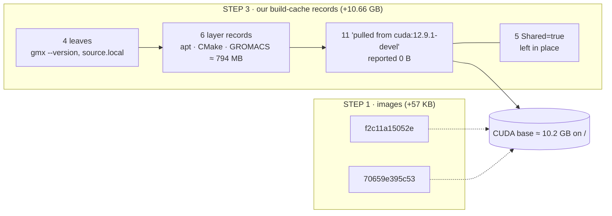

# p53-mdm2 — banyan Docker Cleanup — Findings (v0)

Date: 2026-10-13

---
type: findings
topic: p53-mdm2
date: 2026-10-13
version: v0
prior-version: none
key-metric: banyan space released by removing the transient docker artifacts: 21.26 GB (prior: N/A, delta: N/A; / +10.66 GB, /home +10.59 GB)
decision-required: confirm
---

Attended PI session, outside the umbod cycle machinery. It first verified the reminder *"p53-mdm2 banyan cleanup — retire the old gromacs build leftovers (~30 GB)"* (id `usd-p53-mdm2-banyan-cleanup`, due 2026-10-13) read-only. Then, on two PI instructions, it removed everything docker-side that existed only to produce the `.sif`:

1. "proceed with deleting the July and September images: only the `sif` are needed".
2. "Delete gromacs.tar and prune our build-cache records". Removal was to be done without force: if space would not free despite best efforts, stop there.

This report is the durable record. The reminder is not edited, because completed reminders are deleted after 90 days.

## Headline Result

metric: banyan free space released by the cleanup (`df -B1`)
value: 21.26
unit: GB (`/` +10 664 960 000 B; `/home` +10 594 041 856 B)
prior: N/A (first run; the reminder estimated ~30 GB)
direction: new

**Done, with one wrinkle.** All of the project's transient docker artifacts on banyan are gone except five shared, zero-size build-cache records. Deleting the images *alone* released 57 KB. The space on `/` came back only when the project's own build-cache records were pruned: they held the CUDA base, and `docker system df` reports them as 0 B.

## Results Tables

### What was removed (every command `exit=0`, no blanket prune at any point)

| Step | Artifact | Command | Result |
|---|---|---|---|
| 1 | September image `f2c11a15052e` (`gromacs-p53mdm2:latest`, job 68) | `docker rmi gromacs-p53mdm2:latest` | `Untagged` + `Deleted` |
| 1 | July image `70659e395c53` (untagged, job 30) | `docker rmi sha256:70659e39…` | `Deleted` |
| 2 | `run_20260924T214709Z/gromacs.tar` (10 594 032 640 B) | `rm` | gone; `build.log`, `CONVERT_STATUS`, `convert_verify_out.txt`, `sass_audit_rebuild.txt`, `smoke_run_sif/` kept |
| 3 | 16 of the project's 21 build-cache records | `docker buildx prune -f --filter id=<id>`, one id at a time, repeated until no change | 114 → 98 records |

### Space released per step (`df -B1`)

| Step | `/` free Δ | `/home` free Δ | `docker system df` |
|---|---|---|---|
| 1 — images | +57 344 B | — | Images 45 / 209.6 GB → 43 / 199.1 GB |
| 2 — archive | — | **+10 594 041 856 B** | — |
| 3a — first prune pass (4 leaf records) | +45 056 B | — | Build cache 114 → 110 records |
| 3b — passes 1–3 (12 records, incl. the 11 base refs) | **+10 664 857 600 B** | — | Build cache → 98 records, 16.85 → 16.06 GB |
| **Total** | **+10.66 GB** (393 G → 403 G) | **+10.59 GB** | |

### The project's build-cache records

| Build | Records | Pruned | Left |
|---|---|---|---|
| July, 2026-07-29 14:29–14:31Z | 11 × "pulled from `cuda:12.9.1-devel@sha256:bd4e2680…`" + apt, CMake, GROMACS, `gmx --version` | 10 | 5 base refs marked `Shared=true`, all 0 B |
| September, 2026-09-24 21:47–21:49Z | 2 × `source.local` + apt, CMake, GROMACS, `gmx --version` | 6 | 0 |

### Reminder claims, verified read-only before any deletion

| Claim in the reminder | Status | Evidence |
|---|---|---|
| New sif `221d748e…95fa` exists | ✅ | banyan `fs_checksum` |
| Old sif `1fc04f8b…81ac`, 5.75 GB | ✅ | banyan `fs_checksum`, `ls -l` |
| Parity 7.4e-07 (job 68) and 1.7e-07 (job 59) | ✅ | `convert_verify_cold_banyan.txt` STEP 3c, `dgx1_gpu_smoke_sm70_90.txt` STEP 5 |
| Merged to main at `c6d268c`; manifest seq 12–13 | ✅ | `git merge-base`; all 13 manifest hashes matched disk |
| `dgx1_gpu_smoke.sh` defaults to old sif; `dgx1_sass_vs_jit_probe.sh` hard-codes it | ✅ | lines 41 / 62; cluster copies byte-identical to the repo |
| Nothing else points at the old sif | ✅ | no symlinks under `p53mdm2/`, no crontab or queued jobs on either cluster |
| `gromacs.tar` 10.6 GB; logs and sentinel present | ✅ | `ls -la run_20260924T214709Z` |
| "~10 GB of dangling layers from the July build" | ⚠️ partly | one image, `70659e395c53`, sharing 12 of 15 layers with the September image |
| Daemon store "54 images, 234 GB" | ❌ stale | 45 images / 209.6 GB on 2026-10-13, before we touched it |
| "~30 GB" | ⚠️ | 21.26 GB released; another 5.75 GB if the old sif goes |

## Observations

| Signal | Baseline / Expected | Observed [source] | Interpretation |
|---|---|---|---|
| `/` after removing both images | ≈ +11 GB (estimate given in session) | +57 KB [source: `evidence/banyan_image_cleanup.txt` STEP 1 DELTA] | Image records went, but the layer data stayed on disk. |
| `/` after pruning our records | the base would stay only if someone else referenced it | +10.66 GB once the 11 "pulled from" records were gone [STEP 3] | Our own build-cache records held the base. `docker system df` showed them as 0 B, so step 1 looked like a no-op. |
| Who else references `cuda:12.9.1-devel` | the PI expected nobody | nobody: the store's other "pulled from" records are `cuda:12.8.1-devel` (11, 2026-03-02) and `pytorch:25.04` (61, 2026-03-18) [STEP 3 attribution] | The PI's expectation was right. This session's earlier inference ("held partly by other users' March records") came from a misaligned parse and is withdrawn. |
| Record pruning order | all 21 pruned in one pass | 4 → 9 → 2 → 1 per pass, then none [STEP 3] | A record with child records is not pruned until its children go, so the chain unwinds leaf-first. |
| 5 records left | — | exactly the 5 listed `Shared=true` before pruning, all 0 B [STEP 3] | Shared with another record. Left in place per the PI ("no need to be stubborn"). Released space already ≈ the 10.2 GB base + 0.8 GB of our layers. |
| dgx1 `/home` | separate copy? | NFS from `10.5.1.187:/mnt/raid/homecopy` = banyan; same inode 817636632 [`findmnt`, `stat`] | One file serves both clusters: retiring the old sif on banyan retires it on dgx1. |

## Charts & Visualizations

What held the space, and in what order it came free:



*Dotted lines: references that `docker rmi` removed, and which were not the last holders. Solid lines: the record chain, pruned leaf-first; the base was released when the `P` records went.*

`/` free space across the session (GB, `df -h`):

```
            390      395      400      405
before      |███████████████████████▏           393
STEP 1      |███████████████████████▏           393   (+0.00006)
STEP 3      |█████████████████████████████████▏ 403   (+10.66)
```

## Contradictions & Surprises

- **Two wrong statements from this session, both corrected here.** First, "removing both images frees ~11 GB". The number was about right, but it needed step 3 as well. Second, "the base is held by other users' March records", which came from a misaligned parse of `buildx du`. The evidence file keeps both corrections inline.
- `docker system df` is a poor guide to what an image removal frees here. It never counted the 10.2 GB base under Build Cache, before or after.
- The July cleanup (gate note at `convert_verify_cleanup.md:16`) hit the same wall and named `docker image prune` across other users' images as the remedy. The actual lever was pruning our own build-cache records, which was in scope all along.
- The store shrank from 54 / 234.6 GB to 45 / 209.6 GB between 2026-09-24 and 2026-10-13 without us, and the `cuda:12.9.1-devel` tag went with it. Other users are cleaning up too.

## Steering Questions

- [now] Retire the old `gromacs.sif` (5.75 GB). First repoint `dgx1_gpu_smoke.sh` (default) and `dgx1_sass_vs_jit_probe.sh` (hard-coded) to the new sif, then delete it rather than symlink it: a symlink would silently change what the probe measures. Evidence seq 3–11 cite the old image by digest and stay valid.
- [now] Tick the gate at `convert_verify_cleanup.md:16`? "No archive and no `gromacs-p53mdm2` image remain, `/` recorded before and after, reclaimed space actually released" are all now met. The 5 shared zero-size records are the only residue. This goes through `managing-roadmaps`, not a hand edit.
- [next run] Update `examples/p53_mdm2/cluster/README.md` lines 20, 301 and 658, which still name the old sif as the delivered artifact.
- [later] For future builds on banyan, put a builder-cache prune by record ID in the cleanup step of `convert_verify.sh`, so the release no longer depends on someone remembering this report.

## Pointers

- `examples/p53_mdm2/cluster/evidence/banyan_image_cleanup.txt` (manifest seq 14)
- `examples/p53_mdm2/cluster/evidence/convert_verify_cold_banyan.txt` (seq 12), `dgx1_gpu_smoke_sm70_90.txt` (seq 13)
- `__roadmap__/p53-mdm2-v2/p1b_container_runtime/sif_delivery/convert_verify_cleanup.md` (Step 5, gate line 16)
- `examples/p53_mdm2/cluster/README.md` lines 20, 301, 658
- [13-route_b_build_observed_v0.md](13-route_b_build_observed_v0.md) (origin of `70659e395c53`)
