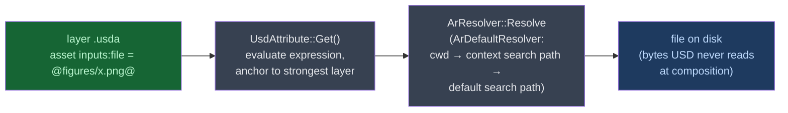
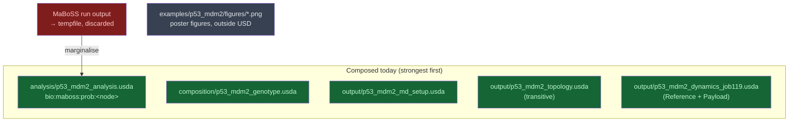
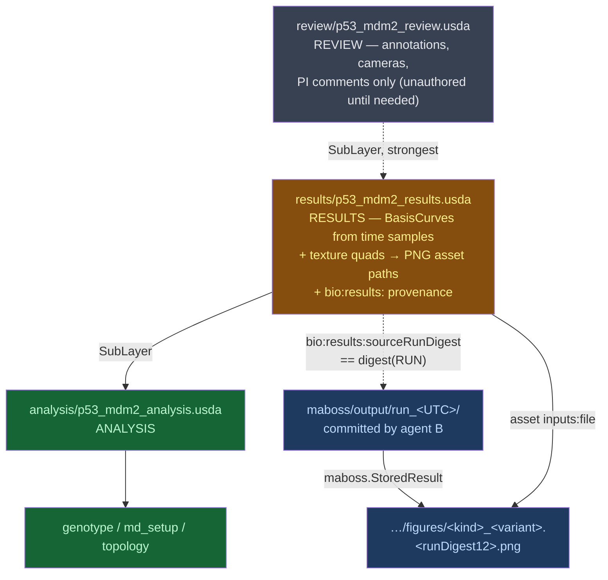

# p53-mdm2 — Results Layer and Plot PNGs as Texture Assets: Architecture Analysis (v0)

Date: 2026-11-06
Cycle: cycle-013, Unit A
Author: Claude Opus 5.5 (async sub-agent)
Answers: the PI's three follow-up questions in the 2026-09-22 answer to **Q-013** `[source: __threads__/p53-mdm2/QUESTIONS.md, Q-013 *answer*]`
Supersedes: the opacity rule and the Review-layer placement in [R15](15-results_consumption_boundary_v0.md), both overruled by that answer

> **Tagging.** Claims carry `[source: …]` (a file in this repo, or an OpenUSD page retrieved through the context7 MCP server, library `/websites/openusd_release`), `[observed: …]` (I ran it this cycle), `[inference]` (follows from tagged facts), or `[assumption: …]` (not verified). Sections marked **RECOMMENDATION** are proposals.

---

## The three answers, short

| PI question | Answer |
|:--|:--|
| **"How are textures usually handled with OpenUSD?"** | A texture is a file outside the layer. The layer refers to it through an **asset-valued attribute**, `asset inputs:file = @path@` on a `UsdUVTexture` shader. USD stores the path, not the pixels. The **asset resolver** (`ArResolver`) turns that path into a file. The default resolver only anchors and searches paths. Versioning is left to the pipeline: either a custom resolver, or a version written into the path or into `assetInfo`. |
| **"How do you suggest to avoid stale ones?"** | Name each PNG after a **digest of the committed MaBoSS run it was drawn from**, not after its own bytes. Record that digest and the PNG's SHA-256 on the shader prim. Then add a test that recomputes both from disk. Stale means "drawn from a run that is no longer the committed one". After this change, a stale PNG always has a wrong path and fails one deterministic check. No re-rendering is needed. |
| **"The asset should simply be renamed … and the most recent one always wins?"** | **Renaming: yes.** That is the core of the guard above. **"Most recent wins": no.** USD has no such mechanism. With the default resolver, a file path has no notion of recency. The stage uses the one path that the strongest opinion authors. A new file wins only once a layer is re-authored to name it. Recency semantics would need a custom resolver plugin. The working rule is **"the layer pins one version, and a test proves the pin matches the committed run"**. |
| **"What would it cost to have results as their own layer?"** *(Q-013.2)* | About one SubLayer entry more than putting them in Review would have cost. The work is one new layer file, one builder, one test module, and one line in `source_layers()`, plus small edits to README and `test_integrated.py`. It adds no new arc and no new stage metadata. The real cost is **a change to the design doc's department table** (five rows become six), and that is the PI's decision. Review stays unauthored until there are annotations to put in it. |

---

## Executive Summary

- **Problem.** Q-013's answer overrules R15's opacity rule: rendered MaBoSS plots will be committed and referenced from USD, the way artists' textures are. R15 named one cost, that a stale PNG looks identical to a fresh one, and the PI asked how to avoid it. The PI also moved result curves out of Review and asked what a separate Results layer costs.
- **Proposed change.** (1) A sixth department, **Results**, holds the curve geometry and the PNG texture references, separate from a Review layer reserved for annotations. (2) PNGs carry **data-addressed filenames** plus recorded digests, with a deterministic stale test. (3) P6 is re-scoped to match (see §Roadmap Handoff).
- **Non-goals.** No edit to `__design__/`, since the department-table change is flagged for the PI. No code in `examples/`: agent B owns the run-directory commit this cycle. No custom `ArResolver`. No state-space payload, per Q-013.4.
- **Biggest risks.** PNG bytes change with matplotlib version even when the pixels do not. Texture quads have to be placed in Ångström world space. The PI may prefer a different department name or number.
- **Validation approach.** The stale guard is checked by recomputing digests from committed files and never by rendering. Re-rendering is an optional second check, and it compares data, not pixels, whenever the matplotlib version differs.

---

## How OpenUSD handles textures — what the docs actually say



| Mechanism | What OpenUSD says | What it means here |
|:--|:--|:--|
| **Texture slot** | `UsdUVTexture` declares `asset inputs:file = @@`, "Path to the texture this node uses". The tutorial sets it to a bare `"USDLogoLrg.png"` `[source: context7 /websites/openusd_release — spec_usdpreviewsurface.html; tut_simple_shading.html]` | A texture is a **path**. The layer holds no pixel data. |
| **Relative anchoring** | For `SdfAssetPath` attributes, `Get()` evaluates variable expressions and resolves. "The layer that has the strongest value opinion is used as the anchor for 'relative' asset paths" `[source: context7 — api/class_usd_attribute.html]` | A path authored in `results/…usda` resolves relative to `results/`, whichever layer SubLayers it. That makes it safe to compose. |
| **Default resolver** | `ArDefaultResolver` anchors a relative path to the current directory, then the context's search paths, then the default search path, and "return[s] the first absolute path where the asset exists" `[source: context7 — api/class_ar_default_resolver.html]` | "First match in search order" is the only selection rule. Nothing in it looks at time or version. |
| **Versioning** | The `ArResolver` interface can be customised "allowing … site-specific naming conventions to be resolved, and for dynamic versioning control to be applied". The shipped default is "simple 'search-path' style" `[source: context7 — intro.html]`. URI-scheme resolvers are plugins registered by `plugInfo.json` `[source: context7 — api/ar_page_front.html; wp_ar2.html]` | **Dynamic versioning is something a resolver plugin provides.** USD does not do it by default. |
| **Version metadata** | `assetInfo` promotes `identifier`, `name`, `version` and `payloadAssetDependencies`. For `version`: "In some pipelines, it may make sense to inject an asset's revision control version into the published asset itself. In other pipelines, version is tracked in an external database" `[source: context7 — glossary.html]`. `SetAssetInfoByKey` lives on `UsdObject`, so prims, attributes and relationships all have it `[source: context7 — api/class_usd_object.html; class_usd_relationship.html]` | There is a standard slot for "which version". USD records what is written there and enforces nothing about it. |
| **Path templating** | `<UDIM>` in `inputs:file` stands for a tile set, e.g. `@textures/occlusion.<UDIM>.tex@`, tiles 1001–1100 `[source: context7 — spec_usdpreviewsurface.html]`. **Variable expressions** select a path from root-layer `expressionVariables`. They "do not compose across sublayers", only across references and payloads `[source: context7 — user_guides/variable_expressions.html]` | A path can be a template. A pin by variable would have to live in the integrated **root** layer, not in the Results SubLayer. |
| **Change detection** | `SdfLayer::Reload` compares the file's mtime with its load time and consults external asset dependencies. `ArDefaultResolver` provides `GetModificationTimestamp` `[source: context7 — api/class_sdf_layer.html; class_ar_resolver.html]` | This mtime mechanism serves **reload**, not selection. It tells a session that a file changed. It never chooses the newer of two files. |
| **Dependency enumeration** | `UsdUtilsComputeAllDependencies` returns resolved layers, non-layer assets, and **unresolved paths** `[source: context7 — api/dependencies_8h.html]` | A test can list every PNG a stage points at, and every dangling path, using a USD API rather than a regex. |

**Where the texture analogy holds, and where it breaks.** `[inference]` The mechanism carries over exactly: a plot PNG goes in the same `inputs:file` slot as an artist's texture. The staleness profile does not carry over. An artist's texture is an *input*: nothing upstream can make it wrong, so a texture pipeline only versions it. A MaBoSS plot is *derived* from a run directory, so it can go out of date with respect to its own source, and versioning alone cannot detect that. A plot therefore needs one thing a texture does not: **a recorded link to its source, and a test of that link.**

**What "most recent wins" would take.** `[inference]` There are three ways to get recency semantics, and none of them comes for free:

1. **Overwrite in place** (same path, new bytes). The path never changes, so a stale file and a fresh file are indistinguishable by path. This is exactly the failure R15 named. On top of that, a running viewer may keep showing the old texture until it reloads `[assumption: Hydra texture caching on reload was not verified in docs this cycle]`.
2. **A custom resolver** that maps a logical name such as `plot:p53_WildType` to the newest version. This works, and it is what the docs mean by "dynamic versioning control". But it is a C++ plugin that every consumer of the stage, including vanilla `usdview`, would have to load. The PI's stated bar is that the stage opens in vanilla `usdview` `[source: __reports__/p53-mdm2/15-results_consumption_boundary_v0.md §Review layer]`, so this breaks that bar.
3. **An expression-variable pin** in the root layer, `@figures/p53.${RUN}.png@`. One variable picks the version, but someone still has to set it, and nothing checks it against the run.

In every case, which file is "most recent" is a fact about the filesystem or about git, and USD cannot see it. **What actually prevents staleness is binding the PNG to its source and testing that binding.** That is the recommendation below.

---

## Current state, and what Q-013 changes



- `[source: examples/p53_mdm2/demos/run_end_to_end.py, source_layers()]` The stack is Analysis → Perturbation → Protocol, strongest first, and Biology is reached transitively. Dynamics joins by Reference and already exercises a Payload `[source: examples/p53_mdm2/README.md §LIVERPS mapping row P]`. **R15's argument that the state-space payload would be "the campaign's first exercised Payload arc" is therefore out of date.** Job-119 took that role in cycle-011 `[source: __reports__/p53-mdm2/README.md, Round 18]`. This weakens the case for the payload half even more than Q-013.4 did.
- `[observed: ls examples/p53_mdm2/figures]` The repo already commits rendered PNG and SVG figures (poster material) **outside** USD, with no stale guard. The new design is the first time a committed image is *referenced from a stage*.
- `[observed: git check-ignore -v]` `.gitignore` does not swallow `*.png` or `maboss/output/run_*/…*.csv`. It does swallow `*.log` (line 99).
- MaBoSS run output is still discarded today `[source: __roadmap__/p53-mdm2-v2/p6_results_consumption/README.md §Gotchas]`. Agent B is committing one run directory this cycle `[source: __threads__/p53-mdm2/cycles/cycle-013/WORKLOG.md]`. Everything below depends on that directory existing.

---

## Proposed state — RECOMMENDATION



### The stale guard

**Definition.** A committed PNG is *stale* when the run directory it was drawn from is no longer the committed run directory. A restyled plot is not stale: the data is the same and only the presentation changed. The guard below detects the first case and records the second.

| Layer of the guard | What it is | What it catches |
|:--|:--|:--|
| **1. Data-addressed path** | The PNG is named `<plotKind>_<variant>.<runDigest12>.png`. `runDigest` is a SHA-256 over the sorted list of (relative path, file SHA-256) for the **files the MaBoSS binary wrote** in the committed run. It excludes `figures/` and any provenance file. | A new run gives every figure a new path. The PI's "rename" idea, keyed on the right thing. |
| **2. Recorded digests on the shader prim** | `bio:results:sourceRunDigest` (full), `bio:results:imageSha256`, `bio:results:generator` (module and entry point), `bio:results:matplotlibVersion`. The Results root prim also carries `assetInfo:version = runDigest`, the slot the USD glossary provides for version `[source: context7 — glossary.html]` | Hand-swapped or edited PNGs (image hash mismatch). The provenance needed to explain a restyle. |
| **3. Deterministic stale test** (required) | The test recomputes `runDigest` from disk and requires it to equal the recorded value and the 12-character filename token. It recomputes the PNG's SHA-256 against the recorded hash. It runs `UsdUtilsComputeAllDependencies` and requires zero unresolved paths, and requires no PNG in `figures/` to go unreferenced by the stage. | Stale, dangling, or orphaned images, with no rendering and no matplotlib dependence. |
| **4. Regeneration check** (optional, slower) | Re-render with `metadata={"Software": None}`. If the matplotlib version equals the recorded one, compare bytes. Otherwise compare **data**: the series `StoredResult` plots against the Analysis time samples. Never compare pixels. | Generator drift in the plotting code itself. |

**Why the path is keyed on the run digest and not on the PNG digest.** `[observed: __reports__/p53-mdm2/evidence/20-png_determinism_probe.py and its captured output 20-png_determinism_probe.txt, run twice in the forOUSD venv]` With matplotlib 3.11.1 under Agg, the same figure rendered in two separate processes produced **identical bytes**. The default PNG also embeds the text chunk `Software: Matplotlib version3.11.1, https://matplotlib.org/`, and passing `metadata={"Software": None}` removes it and changes the hash. `[inference]` A matplotlib upgrade therefore changes PNG bytes even when the pixels are unchanged. With a content-addressed filename, every upgrade would rename every figure and churn the layer with no change in the science. A run-addressed filename changes only when the data changes, which is exactly when a reader needs to notice. Whether the *pixels* themselves change across matplotlib or FreeType versions was not tested `[assumption: inferred from general rasteriser behaviour; only one matplotlib version is installed]`. That is the reason layer 4 compares data and not pixels.

**Weighed against the PI's "rename, most recent wins".**

| Property | Rename + most recent wins | Rename on run digest + pinned + tested *(recommended)* |
|:--|:--|:--|
| New data gives a new path | yes, if someone remembers to rename | yes, mechanically |
| Which file the stage uses | whatever the layer names; "recent" plays no part | whatever the layer names, **proven** to match the run |
| Detects a stale PNG | no: an old name is a valid name | yes: digest mismatch fails a test |
| Needs a custom resolver | yes, for "most recent" to mean anything | no; opens in vanilla `usdview` |
| Old PNGs | accumulate | deleted in the same commit; git keeps the history; orphan check enforces it |

### Results as its own layer — the cost (Q-013.2)

**Strength order.** Strongest first, with the new layer marked: **Review > Results > Analysis > Perturbation > Protocol > Biology**. `[inference]` Results sits above Analysis for the same reason Analysis sits above Perturbation `[source: run_end_to_end.py source_layers() docstring]`: it is derived from what lies beneath it. Review sits above Results because an annotation comments on a result. All of these are **L** (Local and SubLayers) opinions, so the change adds no arc, and LIVERPS is touched only in the L row. If Results authors only under a new `results/` Scope, its namespace is disjoint from Analysis. The order then never decides a value and serves only as convention and a guard against future overlap `[inference]`.

| Cost item | Results in Review *(R15 plan)* | Results as own layer *(Q-013.2)* | Delta |
|:--|:--|:--|:--|
| New `.usda` | `review/p53_mdm2_review.usda` | `results/p53_mdm2_results.usda` (Review deferred) | 0 now; +1 once annotations exist |
| Builder | `templates/build_review_layer.py` | `templates/build_results_layer.py` | 0 |
| Test module + `run_tests.py` registration | `test_review_layer.py` | `test_results_layer.py` (curves, non-destructiveness, stale guard) | 0 |
| `run_end_to_end.source_layers()` | +1 entry | +1 entry now, +1 later | 0 now |
| `test_integrated.py` | must name the new layer in `bio:demo:sourceLayers` `[source: test_integrated.py ~L657–662]` | same | 0 |
| Stage metadata | none: root already owns `metersPerUnit`, `defaultPrim` and time codes, and SubLayers do not contribute them `[source: run_end_to_end.py L465–473]` | same. The Results layer sets its own for standalone opens, as every departmental layer does | 0 |
| Asset paths | n/a (no PNGs under the opacity rule) | anchored to `results/`, so the relative path is `../maboss/output/run_<UTC>/<variant>/figures/…` `[source: context7 — class_usd_attribute.html]` | new: the path depends on B's run-dir name |
| Expression variables | n/a | do not compose across SubLayers. Any `${RUN}` pin must live in the root layer `[source: context7 — variable_expressions.html]` | avoided by not using them |
| README | Review row, LIVERPS L row | Results row, LIVERPS L row, Review still "not yet done" | 0 |
| **Design doc §4.1** | unchanged (Review already listed) | **table gains a row.** PI decision, **not edited here** | **the real cost** |

`[inference]` The engineering delta between the two placements is close to zero today. The only recurring cost is one extra SubLayer entry once a Review layer is written. What the PI is really choosing is **the department table**. Today it maps five film departments to five research concerns `[source: __design__/openusd_for_research_architecture.md §4.1]`. A sixth row needs a film analogue and a file number. **Dailies is not available as the analogue.** Design §3 already maps *Dailies / Director Review* to "PI feedback: 3D annotations, cameras, comments" on the Review layer `[source: __design__/openusd_for_research_architecture.md §3]`, and that is what the PI wants Review to keep. Better candidates: *Surfacing/Texturing*, the department that authors and tracks texture files, which matches the PI's own analogy; or *Comp*. The file numbering options are `05_results.usd` with Review moving to `06_review.usd`, or Results inserted without renumbering. **A second design-doc row is touched as well:** §3 maps *Cinematography → publication visuals → Hydra rendering (Storm/RTX)* `[source: same §3]`. Committing rendered PNGs adds a second route to publication visuals beside Hydra, so that row's wording would need to admit both routes.

---

## Contracts & Invariants

**Placement contract** (supersedes R15's table where they differ)

| Datum | Layer / arc | Prim | Attribute |
|:--|:--|:--|:--|
| node marginals | Analysis / Local | `/p53_MDM2_complex/maboss/<variant>` | `bio:maboss:prob:<node>`, **unchanged** |
| result curves | **Results** / Local | `/p53_MDM2_complex/results/<variant>/<node>` | linear `UsdGeomBasisCurves`, with axis mapping as `bio:results:frameRange`, `probRange`, `plotWidth`, `plotHeight` |
| plot texture | **Results** / Local | `/p53_MDM2_complex/results/figures/<kind>_<variant>` (Mesh quad + Material + `UsdUVTexture` + `UsdPrimvarReader_float2`) | `asset inputs:file`, plus `bio:results:sourceRunDigest`, `imageSha256`, `generator`, `matplotlibVersion` |
| results version | **Results** / Local | `/p53_MDM2_complex/results` | `assetInfo` `version = runDigest` |
| annotations, cameras, PI comments | **Review** / Local | `/p53_MDM2_complex/review/…` | `bio:review:` (unauthored) |

The namespace changes from R15's `bio:review:` to `bio:results:` for everything except annotations `[inference: follows from Q-013.2]`.

**Invariants**

1. Every `asset` path to an image in a committed `.usda` resolves, and lies under the committed run directory's `figures/`.
2. `bio:results:sourceRunDigest` equals the run digest recomputed from disk, and that digest's 12-character prefix appears in the filename.
3. `bio:results:imageSha256` equals the SHA-256 of the file it describes.
4. No PNG under `figures/` is unreferenced by the composed stage.
5. Opening Analysis alone resolves no `results/` Scope and no `bio:results:` attribute. This is the non-destructiveness pattern already applied to Biology `[source: examples/p53_mdm2/README.md §Departmental layering, verified]`.
6. Every curve vertex inverts, through the recorded mapping, to a `bio:maboss:prob:<node>` sample on the same stage.

**Error model.** If the run directory or the Results layer is absent, the module returns **zero rows**, because the harness has no skip concept `[source: p6_results_consumption/README.md §Gotchas]`. A digest mismatch is a failing row, and its detail names both digests. The regeneration check returns zero rows if the recorded matplotlib version differs and the data-level comparison is not implemented yet.

---

## Alternatives Considered

| # | Option | Verdict | Reason |
|:--|:--|:--|:--|
| A | Overwrite the PNG in place, with a fixed path | Rejected | Stale and fresh look identical by path; this is R15's failure class unchanged |
| B | Rename by hand, "most recent wins" | Rejected as stated | USD has no recency semantics without a resolver plugin, and a valid old name cannot be detected as stale |
| C | Content-addressed name (PNG SHA-256) | Rejected as the *name* key, kept as a recorded hash | Changes on every matplotlib bump, because of the embedded `Software` chunk `[observed]` |
| D | **Run-digest name + recorded digests + deterministic test** | **Chosen** | Changes exactly when the data changes, is checkable without rendering, and works in vanilla `usdview` |
| E | Custom `ArResolver` mapping logical names to the latest version | Rejected for now | A plugin every consumer must load, and it breaks the vanilla-`usdview` bar |
| F | `expressionVariables` pin `${RUN}` in the root layer | Not chosen | Root-layer only; adds indirection with no verification of its own; could be layered on D later |
| G | Pixel-diff regeneration test | Rejected | Fragile across rasteriser versions `[assumption]`. Data-level comparison tests what matters |
| H | Results inside Review (R15) | Rejected by PI | Q-013.2: Review is annotations only |

---

## Risks & Mitigations

| # | Risk | Severity | Mitigation |
|:--|:--|:--|:--|
| 1 | The run-digest definition depends on agent B's file list, and a provenance file inside the run dir would make the digest self-referential | Medium | Digest only the files the binary wrote, and exclude provenance and `figures/`. Fix the list once B's layout lands |
| 2 | Texture quads in Ångström space are invisible or huge next to a ~50 Å complex | Medium | Reuse the curve plot box's recorded mapping. Record what `usdview` shows; do not predict it |
| 3 | `usdview` or Hydra keeps an old texture cached after regeneration | Low | The run-digest path makes a new run a new path, so no cache key is reused `[assumption: Hydra caches by resolved path]` |
| 4 | The PI wants a different department name or number | Low | No design doc edit was made. The leaves use `results/` and `bio:results:`, which survive either numbering |
| 5 | The repo's existing poster PNGs under `figures/` have no guard | Low | Out of scope. They are not referenced by a stage. Noted for the PI |
| 6 | `assetInfo` on attributes is unconventional; the glossary frames it for model root prims | Low | Put `assetInfo` only on the Results root prim, and carry per-texture provenance as `bio:results:` attrs `[source: context7 — class_usd_object.html]` |

---

## Roadmap Handoff

Applied this cycle with `dirtree-rdm` 0.1.0. Every file passes `validate`.

```
p7_md_trajectory_integration.md          → done (6/6 gates ✅, cycle-012, PI-acked)
p6_results_consumption/
  review_layer_plots.md                  → blocked: Review is annotations-only (Q-013.2)
  results_layer_curves.md                NEW — curves in a Results SubLayer
  raw_probtraj_payload.md                trimmed to Step 1 (commit one run dir; agent B)
  state_space_payload.md                 NEW → blocked: Q-013.4 (Steps 2–3 preserved)
  native_plots/
    pymaboss_stored_result_plots.md      re-scoped: committed PNGs as texture assets + stale guard;
                                         the "no image asset path" gate is removed
```

`[inference]` Depth still encodes the single real dependency. The PNGs need the run directory, and the texture references need the Results layer to exist, so both wait one BFS level behind the depth-0 leaves.

---

## Candidate steering questions

1. **Department table.** Should Results become a sixth row in design doc §4.1? If so, which film analogue (Surfacing/Texturing or Comp; Dailies already belongs to Review in §3) and which number: `05_results` with Review moving to `06`, or Results inserted without renumbering? Should §3's Cinematography row ("Hydra rendering") also admit committed images? These are design-doc changes, and only the PI can authorise them.
2. **Stale guard as recommended?** Should PNGs be named on the *run* digest (stable across matplotlib upgrades), or on their own content hash (stricter, but churns on every upgrade)?
3. **Optional regeneration check.** Should the suite carry the slower re-render check (layer 4), or is the digest check (layer 3) enough at this scale?
4. **Existing poster figures.** `examples/p53_mdm2/figures/*.png` are committed with no stale guard. Should they get the same guard, or stay out of scope as unreferenced presentation material?
5. **Payload half.** R15 justified the state-space payload partly as the "first exercised Payload arc", and job-119 now holds that role. Should `state_space_payload` stay blocked permanently, or be revived once the model grows beyond five nodes?

---

## What I am uncertain about

- **Pixel stability across matplotlib or FreeType versions** is untested; only 3.11.1 is installed. Byte identity was observed only within that version.
- **Hydra texture caching** on regeneration or reload was not confirmed in the docs.
- **Agent B's run-directory layout** (names, provenance file, whether `figures/` lives inside it) was not visible to me. The digest definition will need a one-line adjustment once it lands.
- **The Amendment Log rows** for P6 could not be written through `dirtree-rdm`. Version 0.1.0 has no command that writes the Amendment Log (its commands are init, add, status, update, move, insert, validate, ls, grammar). The project rules forbid hand-editing that table, so the amendment is recorded in the leaves' prose and in this report, and the log row is left to the coordinator or PI. The repo's one existing row (`A0` in the root README) appears to have been written by hand `[inference: no tool path exists]`.
- **Dedup of a layer reached twice in a stack.** If Results SubLayers Analysis and the root also lists Analysis, Analysis appears twice. The existing stack already reaches topology through both Analysis and Protocol `[source: analysis/p53_mdm2_analysis.usda and output/p53_mdm2_md_setup.usda headers]`, and the suite passes, so I infer this is harmless. I did not test it for the new layer.
